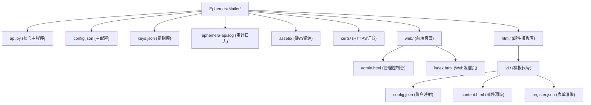

# EphemeraMailer
A zero-dependency, single-file mail gateway based on pure Python. (Alpha / WIP)
# EphemeraMailer (蜉蝣邮件网关)

**Early Development / 早期开发阶段**

EphemeraMailer 目前处于未完全版（Alpha）状态。虽然核心发信与后台管理功能已跑通，但仍存在已知或未知的 Bug。
**请勿直接用于极其关键的生产环境**。项目正在快速迭代中，欢迎提交 Issue 或 Pull Request 一起完善。

基于 Python 纯原生标准库打造的单文件邮件发信网关。

## 命名由来

**Ephemera** 意为“蜉蝣”，朝生暮死，极其短暂。本项目的设计哲学正是如此：轻量、极速、发信即走、用完即毁。不依赖复杂的连接池和重型框架，不留常驻的庞大数据结构。一封邮件的旅程，就是这个系统的生命周期。

## 核心特性

- **零依赖**：不依赖 Flask/FastAPI，不依赖 Redis/MySQL，只需一个 api.py 即可运行。
- **配置驱动**：随时在 html 目录新建文件夹和 JSON 配置，即可动态扩展发信模板与参数校验。
- **热加载**：修改模板的 HTML 和 JSON 无需重启服务，即时生效。
- **高级管理控制台**：自带自适应主题控制台，支持暗色/亮色模式切换（含浅米黄与浅绿护眼色）。
- **自定义壁纸**：通过配置开启后，自动读取 assets 目录的背景图，带有智能遮罩防刺眼。
- **内置安全机制**：包含双层滑动窗口限流、防目录穿越、防邮件头注入、密钥文件原子写入防损坏。
- **并发控制**：纯原生线程池加信号量管控，发信不卡主线程。

## 运行要求与占用

- 运行环境：Python 3.6 及以上。
- 内存占用：单进程空闲状态下约为 20MB - 40MB（不含高并发发信时的线程池动态开销）。

## Termux 部署教程

本项目可以直接在 Android 手机的 Termux 上运行，运行后在本地即可进行管理与控制

1. 安装基础环境
更新并安装 Python：
pkg update && pkg upgrade -y
pkg install python -y

2. 获取源码
git clone https://github.com/MCHESMCS/EphemeraMailer.git
cd EphemeraMailer

3. 运行与配置
python3 api.py
首次运行会自动触发终端交互式配置向导。

4. 后台常驻运行
nohup python3 api.py > run.log 2>&1 &

5. 防止被系统杀后台
在 Android 设置中，将 Termux 的电池优化设置为“无限制”，并允许后台运行。

## 快速开始

直接运行：
python3 api.py

## 目录结构



## 已知问题

当前版本仍存在以下需要改进的技术缺陷，欢迎提交 PR 修复：
- 日志 API 参数注入：/api/admin/logs 对 lines 参数未做严格的正整数限制，传入负数可能引发 deque 异常。
- enable_get 作用域：该开关目前未能全局生效，部分内部路由可能未被限制。
- 前端密钥明文暴露：管理端在请求密钥列表时，通过明文 JSON 返回了完整的 Key，计划后续改为仅返回掩码。
- HTTP 强制关闭机制缺失：在仅开启 HTTPS 服务时，HTTP 端口暂时无法在配置层被强制关闭。
- 大文件性能问题：当 keys.json 包含数千条密钥时，全量内存读取机制会导致轻微的性能下降。
- 高并发热加载边界：在每秒上千次切换模板配置的极端压测下，可能存在微小的文件读取冲突。

## 开发路线

- [x] 单文件极简架构与动态模板引擎
- [x] 可视化管理控制台与多主题适配
- [x] 纯原生线程池发信与防刷限流
- [ ] 多租户架构：支持多租户文件隔离与公私有配置。
- [ ] 多级权限管理：引入站点 Owner 与子站管理员角色划分。
- [ ] V2.0 分布式规划：控制面与数据面分离的边缘发信节点。


# Mail Gateway API 文档

## 接口通用说明

- 所有响应头统一返回 `Content-Type: application/json; charset=utf-8`
- 成功响应标准格式：`{"ok": true, ...}`
- 失败响应标准格式：`{"ok": false, "error": "错误描述"}`

---

## 一、业务发信接口

### 1. 发送邮件（动态模板）

- **路径**：`/api/{template_name}/send`
- **方法**：GET 或 POST
- **说明**：根据 `{template_name}` 动态调用 `html/` 下对应的模板进行发信。受 `config.json` 中的 `enable_get` 开关限制 GET 请求。

**参数（Query 或 Form/JSON）**

| 参数 | 必填 | 说明 |
| --- | --- | --- |
| `TO` | 是 | 收件人邮箱地址 |
| `KEY` | 是 | 发信凭证（支持 `send` 或 `admin` 权限） |
| 其他参数 | — | 根据模板的 `config.json` 中定义的 `incoming` 规则传入 |

**GET 请求示例**

```http
GET /api/v1/send?TO=test@qq.com&KEY=YOUR_API_KEY&code=123456 HTTP/1.1
Host: 127.0.0.1:8088
```

**POST 请求示例（JSON）**

```http
POST /api/v1/send HTTP/1.1
Host: 127.0.0.1:8088
Content-Type: application/json
Content-Length: 86

{
    "TO": "test@qq.com",
    "KEY": "YOUR_API_KEY",
    "code": "123456"
}
```

**返回示例**

```json
{"ok": true, "msg": "accepted"}
```

---

### 2. Web 表单发信

- **路径**：`/api/web_send`
- **方法**：POST（`application/x-www-form-urlencoded`）
- **说明**：专供前端 Web 发信页使用的接口，不受 `enable_get` 开关限制。

**参数**

| 参数 | 必填 | 说明 |
| --- | --- | --- |
| `template` | 是 | 模板名称（如 `v1`） |
| `TO` | 是 | 收件人邮箱地址 |
| `KEY` | 是 | 发信凭证 |
| 其他参数 | — | 根据对应模板动态传入 |

**请求示例**

```http
POST /api/web_send HTTP/1.1
Host: 127.0.0.1:8088
Content-Type: application/x-www-form-urlencoded
Content-Length: 65

template=v1&TO=test@qq.com&KEY=YOUR_API_KEY&code=123456
```

**返回示例**

```json
{"ok": true, "msg": "accepted"}
```

---

### 3. 获取可用模板列表

- **路径**：`/api/templates`
- **方法**：GET
- **说明**：供前端 Web 发信页拉取可用的模板。会自动过滤掉 `register.json` 中标记为 `is_api_only: true` 的模板。

**请求示例**

```http
GET /api/templates HTTP/1.1
Host: 127.0.0.1:8088
```

**返回示例**

```json
{
  "ok": true,
  "templates": [
    {
      "id": "v1",
      "name": "验证码通知",
      "fields": [
        {"key": "code", "label": "验证码", "placeholder": "请输入验证码", "type": "text"}
      ]
    }
  ]
}
```

---

## 二、管理后台接口（Admin API）

> **注意**：所有 Admin API 必须携带请求头 `X-Admin-Key: <您的Admin权限密钥>`。

### 1. 获取密钥列表

- **路径**：`/api/keys`
- **方法**：GET

**请求示例**

```http
GET /api/keys HTTP/1.1
Host: 127.0.0.1:8088
X-Admin-Key: YOUR_ADMIN_KEY
```

**返回示例**

```json
{"ok": true, "keys": [{"id": 1, "key": "...", "status": "active", "perm": "admin", "created": "...", "note": "..."}]}
```

---

### 2. 创建新密钥

- **路径**：`/api/keys/create`
- **方法**：GET

**参数**

| 参数 | 说明 |
| --- | --- |
| `perm` | 权限级别，可选 `send` 或 `admin` |
| `note` | 备注信息 |

**请求示例**

```http
GET /api/keys/create?perm=send&note=测试专用 HTTP/1.1
Host: 127.0.0.1:8088
X-Admin-Key: YOUR_ADMIN_KEY
```

**返回示例**

```json
{"ok": true, "id": 2, "key": "新生成的密钥", "perm": "send"}
```

---

### 3. 吊销密钥

- **路径**：`/api/keys/revoke`
- **方法**：GET

**参数**

| 参数 | 说明 |
| --- | --- |
| `id` | 密钥 ID |

**说明**：将指定密钥状态置为 `revoked`。

**请求示例**

```http
GET /api/keys/revoke?id=2 HTTP/1.1
Host: 127.0.0.1:8088
X-Admin-Key: YOUR_ADMIN_KEY
```

**返回示例**

```json
{"ok": true, "revoked_id": "2"}
```

---

### 4. 修改密钥权限

- **路径**：`/api/keys/perm`
- **方法**：GET

**参数**

| 参数 | 说明 |
| --- | --- |
| `id` | 密钥 ID |
| `perm` | 新权限，可选 `send` 或 `admin` |

**请求示例**

```http
GET /api/keys/perm?id=2&perm=admin HTTP/1.1
Host: 127.0.0.1:8088
X-Admin-Key: YOUR_ADMIN_KEY
```

**返回示例**

```json
{"ok": true, "id": "2", "perm": "admin"}
```

---

### 5. 创建或覆盖邮件模板

- **路径**：`/api/admin/create_template`
- **方法**：POST（`application/x-www-form-urlencoded`）

**参数**

| 参数 | 说明 |
| --- | --- |
| `id` | 模板 ID（仅支持字母数字短横线） |
| `name` | 模板显示名称 |
| `account` | 发信账户名 |
| `subject` | 邮件标题 |
| `api_fields` | API 传参映射，格式 `参数名:占位符`，逗号分隔 |
| `html` | 邮件正文 HTML 源码 |
| `is_web` | 是否在 Web 前端显示（`true`/`false`） |
| `web_fields` | Web 前端表单映射，格式 `显示名;入参`，逗号分隔 |

**说明**：自动在 `html/` 下生成对应目录及配置文件。

**请求示例**

```http
POST /api/admin/create_template HTTP/1.1
Host: 127.0.0.1:8088
X-Admin-Key: YOUR_ADMIN_KEY
Content-Type: application/x-www-form-urlencoded
Content-Length: 234

id=v2&name=新模板&account=default&subject=测试主题&api_fields=code:%7Bcode%7D&html=%3Ch1%3EHello%3C%2Fh1%3E&is_web=true&web_fields=验证码;code
```

**返回示例**

```json
{"ok": true, "msg": "template created/updated successfully"}
```

---

### 6. 增量更新模板信息

- **路径**：`/api/admin/update_template`
- **方法**：POST

**参数**

| 参数 | 说明 |
| --- | --- |
| `id` | 模板 ID |
| `name` | 新显示名称（可选） |
| `web_fields` | 新 Web 表单映射（可选） |

**说明**：留空不传的字段保持原样，仅更新传入的字段。

**请求示例**

```http
POST /api/admin/update_template HTTP/1.1
Host: 127.0.0.1:8088
X-Admin-Key: YOUR_ADMIN_KEY
Content-Type: application/x-www-form-urlencoded
Content-Length: 42

id=v1&name=更新后的名字&web_fields=验证码;code
```

**返回示例**

```json
{"ok": true, "msg": "template info updated successfully"}
```

---

### 7. 启用/禁用 Web 模板

- **路径**：`/api/admin/toggle_template_web`
- **方法**：POST

**参数**

| 参数 | 说明 |
| --- | --- |
| `id` | 模板 ID |
| `action` | `enable` 或 `disable` |

**说明**：切换 `register.json` 中的 `is_api_only` 状态。

**请求示例**

```http
POST /api/admin/toggle_template_web HTTP/1.1
Host: 127.0.0.1:8088
X-Admin-Key: YOUR_ADMIN_KEY
Content-Type: application/x-www-form-urlencoded
Content-Length: 20

id=v1&action=disable
```

**返回示例**

```json
{"ok": true, "msg": "template web disabled"}
```

---

### 8. 获取系统运行状态

- **路径**：`/api/admin/system_info`
- **方法**：GET
- **说明**：获取内存占用、队列数、发信统计等监控数据。

**请求示例**

```http
GET /api/admin/system_info HTTP/1.1
Host: 127.0.0.1:8088
X-Admin-Key: YOUR_ADMIN_KEY
```

**返回示例**

```json
{
  "ok": true,
  "uptime": "2h 15m 30s",
  "running_tasks": 0,
  "total_success": 7994,
  "total_fail": 12,
  "total_reject": 100000,
  "reject_1m": 0,
  "template_count": 2,
  "account_count": 1,
  "mem_used_mb": 45,
  "mem_total_mb": 4096
}
```

---

### 9. 读取系统日志

- **路径**：`/api/admin/logs`
- **方法**：GET

**参数**

| 参数 | 说明 |
| --- | --- |
| `lines` | 拉取最后 N 行日志（默认 50，最大 500） |

**请求示例**

```http
GET /api/admin/logs?lines=100 HTTP/1.1
Host: 127.0.0.1:8088
X-Admin-Key: YOUR_ADMIN_KEY
```

**返回示例**

```json
{"ok": true, "logs": "[2026-10-24 18:03:29] START HTTP API on :8088\n..."}
```

---

### 10. 获取全量模板列表

- **路径**：`/api/admin/list_templates`
- **方法**：GET
- **说明**：与 `/api/templates` 不同，此接口包含被隐藏的纯 API 模板。

**请求示例**

```http
GET /api/admin/list_templates HTTP/1.1
Host: 127.0.0.1:8088
X-Admin-Key: YOUR_ADMIN_KEY
```

**返回示例**

```json
{"ok": true, "templates": [{"id": "v1", "name": "验证码", "is_web": true}]}
```
